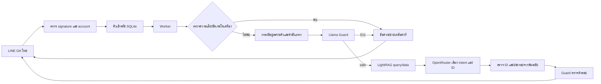

# UNNAMED Chatbot — Python

ต้นแบบสำหรับ LINE OA ใหม่ ใช้ FastAPI + LightRAG + OpenRouter และ endpoint สำหรับ Llama Guard แยกจากระบบร้านเดิม ไม่มีการจองคิวหรืออ่านฐานข้อมูลลูกค้าเดิม

## ตรวจความพร้อมก่อนทดสอบ LINE

จากโฟลเดอร์ `C:\Work\KMITL\Chatbot\unnamed\unnamed-chatbot-python` หลังเปิด Ollama, LightRAG, backend และ Tunnel แล้ว รัน:

```powershell
powershell -ExecutionPolicy Bypass -File .\scripts\check-ready.ps1
```

คำสั่งนี้อ่านสถานะเท่านั้น ไม่เรียก chat completion, moderation, embedding หรือ LightRAG query ไม่ ingest เอกสาร ไม่ส่ง LINE และไม่แก้ webhook/คีย์/โควตา ตรวจ backend และ revision ของฐานความรู้ โมเดลที่ติดตั้ง/โหลดใน Ollama จำนวนเอกสารที่ประมวลผลใน LightRAG โควตาภายในของวันนี้ และอ่านข้อมูลคีย์ OpenRouter กับบัญชี/webhook ของ LINE ใหม่

- `PASS` คือผ่านเฉพาะการตรวจที่ระบุ ไม่ยืนยันว่าบอตตอบจริงผ่านแล้ว
- `WARN` เช่นโมเดลยังไม่โหลด ให้ warmup ตามขั้นตอนเดิม; key limit เกิน $1 ให้ตรวจเพดานใน OpenRouter เอง คำสั่งนี้ไม่เปลี่ยนเพดาน
- `image_moderation: authentication_not_verified` หมายถึงมีคีย์ใน config แต่ยังไม่ได้ส่งภาพเพื่อพิสูจน์ว่าเรียกใช้ได้ เป็นคำเตือนที่ต้องทดสอบผ่าน LINE ภายหลัง
- `FAIL` ให้แก้สาเหตุก่อน เช่น `backend_restart_required`, `models_missing`, `documents_not_ready`, `authentication_failed`, `budget_exhausted` หรือ `webhook_not_ready`
- Exit code 1 เมื่อมี FAIL; 0 เมื่อไม่มี FAIL ซึ่งอาจยังมี WARN จึงต้องอ่านข้อความประกอบ

หากไม่ต้องการติดต่อ OpenRouter/LINE ใช้ `--local-only` และเพิ่ม `--json` สำหรับผลแบบ JSON:

```powershell
powershell -ExecutionPolicy Bypass -File .\scripts\check-ready.ps1 --local-only --json
```

ตัวตรวจนี้ออกแบบสำหรับ backend บน Windows และ Ollama ในเครื่องตามการตั้งค่า README ปัจจุบัน ตรวจเอกสารด้วยจำนวนและสถานะเท่านั้น ไม่พิสูจน์เนื้อหาหรือ hash ในดัชนี และไม่ทดสอบการตอบจริงหรือ URL Tunnel จากภายนอก จึงยังต้อง Verify และทดสอบ LINE เอง คีย์ OpenAI moderation ตรวจเพียงการตั้งค่า ไม่อ้างว่า authentication ผ่าน

## ดู trace ของคำถามและภาพ

หลังอัปเดตโค้ดต้อง restart backend ด้วยวิธีเดิมเพื่อเริ่มใช้ trace ใหม่ ไฟล์อยู่ที่ `data\runtime\diagnostics.jsonl` ของบอตใหม่ เปิดติดตามระหว่างทดสอบได้ด้วย:

```powershell
Get-Content .\data\runtime\diagnostics.jsonl -Tail 30 -Wait
```

แต่ละข้อความ/ภาพมี `request_id` แบบสุ่ม ไม่ใช้ LINE ID หรือรหัสลูกค้ามาสร้าง ID บันทึกเวลาไทยพร้อมเขตเวลา `+07:00` ขั้นที่ทำงาน (`stage`) เวลาที่ใช้ (`duration_ms`) ผล (`outcome`) และรหัสสาเหตุ (`reason`) คำตอบ `/api/chat` มี `request_id` สำหรับจับคู่กับ log ส่วนข้อความใน LINE คงถ้อยคำเดิม ให้ค้นตามเวลาที่ทดสอบแล้วใช้ ID เดียวกันติดตามเหตุการณ์ต่อ

ตัวอย่างสาเหตุ: `rate_limited` คือ provider ตอบ 429, `credit_limit` คือ 402, `budget_day`/`budget_minute` คือโควตาภายในหมด, `timeout` คือหมดเวลารอ, `guard_unsafe` คือถูก Guard ปฏิเสธ, `no_verified_evidence` คือไม่พบเอกสารที่ยืนยันได้, `incomplete_evidence` คือหลักฐานแพ็กเกจไม่ครบ และ `invalid_schema` คือผลโมเดลไม่ตรง schema ไม่พิมพ์คำตอบหรือรายละเอียด error ดิบของ provider ลง trace

`stage_finished` บอกเวลาแต่ละขั้นและ `request_finished` บอกเวลาประมวลผลรวม สำหรับ LINE แยกเวลารอคิวไว้ใน stage `queue` อีกเหตุการณ์หนึ่ง ไฟล์จำกัดประมาณ 1 MB ต่อไฟล์ เก็บไฟล์หลักกับสำรอง 3 ไฟล์ (`.1`–`.3`) โดยไม่เก็บข้อความ รูป โปรไฟล์ user ID, reply token หรือคีย์ใน trace ตั้ง `DIAGNOSTICS_ENABLED=false` ได้หากไม่ต้องการเขียนไฟล์

## การตรวจข้อมูลติดต่อร้านที่เป็นสาธารณะ

เพิ่มบริบทว่าบอตให้ข้อมูลร้านในข้อความที่ส่งให้ input Guard โดยยังเก็บข้อความลูกค้าเต็มประโยคไว้ให้ตรวจ ไม่เปลี่ยนผล unsafe ให้เป็น safe พบการบล็อกผิดกับคำถามรวมเวลาเปิด เบอร์ และแผนที่ใน Llama Guard 3 1B จึงเพิ่มการตรวจสำเนาคำตอบสำหรับข้อมูลติดต่อสาธารณะ

เฉพาะคำตอบ facts ที่อ้าง contact-phone/contact-map/opening-hours เท่านั้น ต้องมีเอกสารค้นคืนตรง canonical ปัจจุบันทุกตัวและคำตอบตรงต้นฉบับทั้งข้อความ จึงแทนเบอร์และ Maps URL ที่ตรงรูปแบบข้อมูลร้านด้วยป้ายข้อมูลสาธารณะในสำเนาส่ง output Guard ตรวจ เนื้อหาส่วนอื่นยังถูกตรวจครบและ Guard ต้องตอบ safe คำตอบจริงที่ส่งให้ลูกค้าไม่เปลี่ยน ไม่มีข้อยกเว้นต่อ unsafe S1/S7 กรณีนี้ และไม่แทนค่าข้อมูลลูกค้าหรือข้อความที่เติมเอง หากหลักฐานไม่ครบ/เก่า/ข้อความถูกแก้ จะตรวจตามเดิมหรือปฏิเสธตามเงื่อนไขหลักฐาน

## การลองใหม่เมื่อ OpenRouter ติดขัด

### เวลาค้น LightRAG และเวลารวมของคำขอ

`RETRIEVAL_TIMEOUT_SECONDS` เริ่มต้น 20 วินาที (ปรับได้ 1–25) เพื่อรองรับขั้นสกัดคำค้นในเครื่องที่บางคำถามใช้เกิน 8 วินาที บอตยังจำกัดเวลาประมวลผลรวมที่ 40 วินาทีเท่าเดิม และงาน LINE ที่รอในคิวจะใช้เวลาตามอายุงานที่เหลือจริง ไม่เริ่มนับ 40 วินาทีใหม่เมื่อเข้า engine

แต่ละคำขอใช้ deadline เดียวกันตั้งแต่ API/worker รวมเวลาของ loading ด้วย การค้นเผื่ออย่างน้อย 2 วินาทีให้ planner พร้อม 4 วินาทีให้ output Guard และ 0.5 วินาทีให้การตรวจ/บันทึกในเครื่อง ส่วน planner ใช้ได้ไม่เกินค่าที่ตั้งหรือเวลาคงเหลือหลังกัน 4.5 วินาทีนี้ หากเวลาไม่พอจะหยุดก่อนจองโควตา/เรียก provider ไม่ส่งคำตอบที่ยังไม่ผ่าน Guard และไม่ retry retrieval ที่ timeout

```dotenv
RETRIEVAL_TIMEOUT_SECONDS=20
```

หลังอัปเดตให้ restart เฉพาะ backend เพื่อโหลดค่าใหม่ ไม่ต้องลบดัชนีหรือเพิ่มโควตา LightRAG การเพิ่มเวลานี้ไม่รับประกันว่าทุกคำถามจะเสร็จภายใน deadline จึงยังต้องดู trace เมื่อมี timeout

### การลองใหม่ของ planner และ Vision

เปิดใช้เป็นค่าเริ่มต้นสำหรับ planner และ Vision เท่านั้น หาก OpenRouter ตอบ HTTP 429 หรือ 503 ก่อนส่ง completion จะลองเพิ่มได้สูงสุด 1 ครั้งโดยใช้โมเดลและนโยบายเดิม ทุกครั้งที่ยิงใหม่ต้องจองโควตา role เดิมเพิ่ม ไม่รีเซ็ตตัวนับ และไม่เปลี่ยนเพดานคีย์ $1

อ่าน `Retry-After` ทั้งรูปจำนวนวินาทีและ HTTP date หากไม่มี header จะรอ 0.5 วินาที หาก header ผิดรูปแบบ ขอให้รอนานกว่า 2 วินาที หรือเวลาไม่พอ จะหยุดและใช้ข้อความระบบไม่พร้อมตามเดิม ไม่ย่นเวลาที่ provider ขอเพื่อยิงซ้ำก่อนกำหนด เวลารอรวมกับทั้งสอง attempt อยู่ใน timeout ของขั้นเดิมและ deadline ทั้งข้อความ 40 วินาที

ไม่ retry HTTP 200 ที่มี error envelope/ผลผิด schema/JSON ผิด, network timeout, 401/402/403 หรือการส่งคำตอบ LINE เพราะไม่ต้องการยิงซ้ำเมื่ออาจประมวลผลไปแล้ว Guard, moderation, retrieval และ LINE loading ไม่ใช้กลไกนี้ การเพิ่มโอกาสตอบสำเร็จไม่รับประกันว่าผู้ให้บริการจะพร้อมในครั้งถัดไป ดูเหตุการณ์ `retry_scheduled`, `retry_attempt`, `retry_skipped` ใน trace

ค่าตัวเลือกใน `.env` ของบอตใหม่ (ถ้าไม่ใส่จะใช้ค่าเริ่มต้นด้านล่าง):

```dotenv
PROVIDER_MAX_RETRIES=1
PROVIDER_RETRY_MAX_WAIT_SECONDS=2
```

ตั้ง `PROVIDER_MAX_RETRIES=0` เพื่อปิด retry; จำนวนเพิ่มสูงสุดถูกจำกัดใน schema ไว้ที่ 1 ครั้ง อ้างอิงชนิดข้อผิดพลาดและ `Retry-After` จาก [เอกสาร OpenRouter](https://github.com/OpenRouterTeam/docs/blob/main/api_reference/errors-and-debugging.mdx)

## แจ้งเมื่อบริบทภาพหมดอายุ

สรุปภาพยังมีอายุเริ่มต้น 5 นาทีเท่าเดิม หากลูกค้าถามโดยอ้างถึงภาพที่หมดอายุจริง เช่น “อยากได้ทรงนี้ ต้องทำบริการอะไร” หลังผ่านตัวกรองและ input Guard แล้ว บอตจะแจ้งให้ส่งรูปใหม่ รอรับภาพ และพิมพ์คำถามตาม ไม่เรียก retrieval/planner หรือใช้สรุปภาพเก่ากับคำถามนี้

คำถามราคาที่ระบุบริการ ข้อมูลร้าน และรายการบริการที่ตอบได้โดยไม่ใช้รูปยังตอบตามหลักฐานได้ ไม่ล้างสถานะหมดอายุเพราะถามเรื่องอื่น คำสั่งเริ่มใหม่ ภาพที่ใช้ตอบสำเร็จ และภาพใหม่ที่แทนภาพเก่า จะล้างสถานะดังกล่าว รวมกรณีภาพใหม่ถูกปฏิเสธหรืออ่านไม่ได้

เพื่อแยก “ภาพหมดอายุ” ออกจาก “ไม่มีภาพ” ระบบเก็บเพียง HMAC owner และเวลาใน `image_expiry_notices` ไม่มีภาพ สรุปภาพ หรือข้อความ เก็บสูงสุด 30 นาทีหลังภาพหมดอายุและจำกัด 1,000 แถว เมื่อเกินช่วงนี้จะไม่อ้างว่ามีภาพเก่าหมดอายุ ตารางถูกสร้างอัตโนมัติเมื่อเริ่ม backend โดยไม่แก้ดัชนี LightRAG

## สถานะกำลังประมวลผลใน LINE

เปิด loading animation ก่อนประมวลผลข้อความ/ภาพในแชตส่วนตัว หลัง webhook รับเหตุการณ์เข้าคิวแล้ว ใช้ Messaging API ของ OA ใหม่นี้เท่านั้น ระยะเวลาเริ่มต้น 40 วินาที และหายเมื่อบอตส่งข้อความกลับ การเรียก loading จำกัดรวม 1 วินาที ไม่ retry และความล้มเหลวไม่หยุดการตอบจริง ทั้งหมดอยู่ใน deadline เดิมของ worker ไม่เรียกสำหรับ event ซ้ำ, rate limit, สื่อไม่รองรับ หรือข้อความช่วยเหลือในเส้นทาง local ที่ตรวจพบความเสี่ยง/ความทุกข์ใจชัดเจน

LINE user ID ที่จำเป็นต่อการแสดง loading อยู่เฉพาะ payload คิวที่เข้ารหัส อายุไม่เกินงานเดิม 55 วินาทีและถูกล้างเมื่อจบงาน ไม่ใส่โปรไฟล์/trace/คำขอ AI ไม่มีการส่ง push message หรือใช้ reply token เพิ่มเพื่อแสดง loading

```dotenv
LINE_LOADING_ENABLED=true
LINE_LOADING_SECONDS=40
```

เลือกเวลาได้ 5–60 วินาที ทีละ 5 วินาที และปิดได้ด้วย `LINE_LOADING_ENABLED=false` ตาม [เอกสาร LINE](https://developers.line.biz/en/docs/messaging-api/use-loading-indicator/) ภาพกำลังประมวลผลแสดงเมื่อผู้ใช้อยู่ในหน้าห้องแชตเท่านั้น หากปิดห้องแชตจะไม่แสดงแจ้งเตือนย้อนหลัง ยังต้องทดสอบการแสดงผลจริงใน LINE เอง

## สถานะปัจจุบัน

มีโหมดทดลองในเครื่องและ adapter สำหรับเชื่อมบริการจริงแล้ว โหมดทดลองใช้การจับคำและฐานความรู้ในไฟล์ **ยังไม่ใช่การทดสอบความเข้าใจของ LLM หรือคุณภาพ LightRAG** โหมดเชื่อมจริงต้องตั้งค่าและทดสอบบริการก่อนใช้งาน ไม่มีการ fallback กลับมาจับ keyword เพื่อตอบข้อมูลร้านเมื่อบริการจริงล่ม ส่วนข้อความช่วยเหลือด้านความปลอดภัยที่เตรียมไว้ใช้ได้โดยไม่เรียกโมเดล

- ข้อมูลบริการปกติ 11 รายการและโปรโมชั่น 5 แพ็กเกจ พร้อมราคา ระยะเวลา พิกัด เวลาเปิด และเบอร์ติดต่อที่ผู้ใช้ยืนยัน
- คำตอบประกอบจากข้อความต้นฉบับที่อนุญาต โมเดลเลือก intent/ID และเป้าหมายผ่าน JSON ที่ตรวจ schema ในแอป ไม่มีช่องให้โมเดลเขียนคำตอบอิสระ
- ถามเป้าหมายและประวัติทำเคมีก่อนให้คำแนะนำ ไม่ถามหรือบังคับระบุความยาวผม มีบริบทแยกผู้ใช้ 30 นาที และคำสั่ง `เริ่มใหม่`
- ส่งรูปแล้วพิมพ์คำถามตามได้: บอตตรวจภาพและตอบรับก่อน จากนั้นใช้ผลวิเคราะห์ภาพล่าสุดกับคำถามเกี่ยวกับภาพ/คำแนะนำถัดไป เก็บเฉพาะ enums แบบเข้ารหัสแยกผู้ใช้ (`IMAGE_CONTEXT_TTL_SECONDS=300` ค่าเริ่มต้น 5 นาที) ไม่เก็บรูปหรือข้อความจากภาพ ไม่ใช้ภาพแทนประวัติเคมี คำถามร้านทั่วไปไม่ใช้ภาพ; ใช้ผลวิเคราะห์ครั้งเดียวหลังตอบสำเร็จ รูปใหม่แทนรูปเดิม และ `เริ่มใหม่` ล้างบริบทภาพด้วย
- บันทึกบริการที่ผู้ใช้ปฏิเสธเป็น enums ในโปรไฟล์เข้ารหัสตลอดอายุบริบท 30 นาที เพื่อไม่แนะนำบริการนั้นหลังตอบคำถามติดตาม ล้างด้วย `เริ่มใหม่` หรือเปลี่ยนใจอย่างชัดเจน เช่น `เปลี่ยนใจอยากดัด` ข้อมูลโปรไฟล์เดิมที่ไม่มีช่องนี้ยังอ่านได้ และโมเดลไม่มีสิทธิ์เขียนช่องนี้เอง คำถามราคาจากภาพยังตอบราคาได้โดยไม่บังคับถามประวัติเคมี
- เพิ่ม local safety fallback สำหรับประโยคขู่แบบมีเงื่อนไข `ถ้าไม่ได้ผมจะไปโดดน้ำ` และตอบรับความรู้สึกสั้นๆ เช่น `ผมเสียใจมากนะ` แบบตายตัว (`safety_route=local_distress`) โดยไม่อ่าน/บันทึกโปรไฟล์ร้าน ไม่เรียก RAG/LLM และไม่ตีความคำว่า `เสียใจ` เป็นผมเสีย กฎแคบนี้ไม่ใช่การวินิจฉัยหรือการรับรองว่าตรวจพบความเสี่ยงได้ทุกสำนวน
- เพิ่มโปรโมชั่น 5 แพ็กเกจในบริการ (`category=promotion`, บริการเดิมถือเป็น `regular`) ตามการยืนยัน 2026-10-17: ฟอก 1 ครั้ง + ทำสี 2,499 บาท / ฟอก 2 ครั้ง + ทำสี 2,999 บาท (90 นาทีขึ้นไปทั้งคู่), เคราตินฟรีตัด 2,400 บาท (180 นาทีขึ้นไป), ดัดฟรีตัด 2,000 บาท (180 นาที), ยืดฟรีตัด 2,400 บาท (150 นาที) ใช้จนกว่าจะเปลี่ยน ไม่ระบุวันหมดอายุ รวม 16 บริการและ 23 เอกสารที่ใช้งาน
- คำถามรายการบริการทั้งหมดขยาย LightRAG เป็น 40 chunks/12,000 context tokens เพื่อค้นรายการให้ครบ; คำถามทั่วไปคง 20 chunks/4,000 tokens หากหลักฐานรายการที่ต้องตอบยังขาด ระบบจะไม่เติมข้อมูลเอง
- แก้ S6 false positive ของรายการโปรโมชั่น 2026-10-17: ยังคงเรียก Guard แต่ยกเว้นผล S6 เพียงหมวดเดียวได้เมื่อเป็นคำตอบ facts ของแพ็กเกจโปรโมชั่นในบริการที่เจ้าของยืนยัน และทั้งเอกสารที่ค้นได้กับคำตอบตรงต้นฉบับปัจจุบันทุกตัวอักษร (รวมข้อความแจ้งข้อมูลที่ขาดแบบตายตัวเท่านั้น) ไม่ใช้กับคำแนะนำ เอกสารเก่า ข้อความเพิ่มเอง หมวด unsafe อื่น หรือ Guard ที่ล้มเหลว; log ระบุ `output_guard_public_promotion_exception category=S6`
- ตรวจ signature, destination และ token identity ของ LINE ใหม่ คิว SQLite เข้ารหัส dedup และจัดลำดับต่อผู้ใช้
- adapter ภาพ JPEG/PNG ผ่าน guard ภาพก่อน Vision; ปิดไว้ตามค่าเริ่มต้น
- ข้อความเสี่ยงทำร้ายตัวเองที่ตรวจได้ในเครื่อง หรือ Guard จัดเป็น S11 ใช้คำตอบช่วยเหลือคงที่ ไม่ค้น RAG/เรียก planner
- Docker Compose, Postman collection, ชุดทดสอบและชุดประเมินภาษาไทย 64 กรณี

ตรวจจริงเมื่อ 12 ตุลาคม 2026: LightRAG สร้างดัชนีครบ 18 เอกสาร; Guard → RAG → OpenRouter ผ่าน FastAPI ครบ 4 คำถามตัวอย่าง; token identity และ LINE webhook verification ผ่านแล้ว ผู้ใช้ส่งข้อความ LINE และได้รับคำตอบแล้ว หลังแก้คำตอบด้านความปลอดภัยผ่าน pytest 113 กรณีและ TCP smoke test; ยังต้องลองคำตอบใหม่จาก LINE จริง ภาพยังปิดอยู่ ดูขอบเขตและผลตรวจล่าสุดใน `TEST_RESULTS.md`

อัปเดตล่าสุด 17 ตุลาคม 2026: ผู้ใช้เลือกทดลอง `qwen/qwen3.5-flash-02-23` แบบเสียเงินทั้ง planner/Vision แทน Dots ฟรีที่ติดโควตา 50/วัน เปิด `ALLOW_PAID_MODELS=true`, ใช้ JSON Schema, temperature=0, ปิด reasoning และคง data_collection=deny/ZDR=false ตามนโยบายเดิม เพดาน OpenRouter key ที่ผู้ใช้กำหนดคือ $1 ไม่แก้ผ่านระบบ ทดสอบจริงราคา รายการบริการ โปรโมชั่น บทสนทนาต่อเนื่อง และภาพวาด/ภาพว่างสังเคราะห์ผ่าน พร้อมเปิดภาพและคง OpenAI omni-moderation-latest + Ollama text Guard ดูผลและข้อจำกัดใน TEST_RESULTS.md; ยังไม่ได้ประเมินภาพถ่ายลูกค้าจริงหรือรับรองความแม่นยำทุกสำนวน

## ทดลองได้ทันทีบนเครื่องนี้

โฟลเดอร์คือ `C:\Work\KMITL\Chatbot\unnamed\unnamed-chatbot-python` มี virtualenv และ `.env` ที่สร้าง local key ใหม่แล้ว ไฟล์ตัวอย่างเริ่มจาก `BOT_MODE=demo` ซึ่งไม่เรียก AI หรือ LINE แต่ `.env` บนเครื่องนี้เปลี่ยนเป็น connected หลังผ่าน smoke test แล้ว หากต้องการทดสอบ offline ให้เปลี่ยนกลับเป็น demo และ restart

เปิด PowerShell ในโฟลเดอร์นี้:

```powershell
.\.venv\Scripts\python.exe -m app.cli check
.\.venv\Scripts\python.exe -m uvicorn app.main:app --host 127.0.0.1 --port 8000 --no-access-log
```

หรือเรียก `powershell -ExecutionPolicy Bypass -File .\scripts\start.ps1` จากโฟลเดอร์นี้ หากนโยบายเครื่องอนุญาต

เปิด Postman แล้ว import [collection](postman/UNNAMED.postman_collection.json) ตั้ง `base_url=http://127.0.0.1:8000` และนำค่า `BOT_ADMIN_KEY` จาก `.env` ใส่ตัวแปร `admin_key` ของ Postman ในเครื่อง เก็บ key เป็นค่า private ไม่ใส่ในไฟล์ collection ที่แชร์

เริ่มที่ Health → Status → ราคาตัดผม → ปัญหาผม → เป้าหมาย → ประวัติ → ล้างบริบท Collection จะจำ `session_id` ของ API เพื่อทดลองคุยต่อในชุดเดียวกัน

ตัวอย่าง `POST /api/chat` มี header `X-Admin-Key` และ JSON:

```json
{"message":"ตัดผมราคาเท่าไหร่","session_id":"optional-demo-session"}
```

ผลลัพธ์มี `reply`, `session_id`, `mode`, `retrieval`, `model_used`, `guard_checked`, `evidence_ids`, `safety_route` เพื่อดูว่ารอบนั้นใช้ส่วนใด `safety_route` เป็น `none`, `local_self_harm` หรือ `guard_self_harm`; เส้นทาง local ไม่ได้เรียก Llama Guard จึงมี `guard_checked=false` `GET /healthz` บอกว่าแอปทำงานอยู่เท่านั้น ไม่ยืนยันว่าบริการภายนอกพร้อม

API `/api/chat` เป็นเครื่องมือทดลองสำหรับผู้ดูแล ไม่ใช่ API สาธารณะสำหรับแจก admin key ให้ลูกค้า ช่องทางลูกค้าคือ webhook LINE

## ติดตั้งบนเครื่องใหม่

ใช้ Python 3.12 และ `uv` หรือ pip แล้วสร้าง `.venv` ใหม่ ตัวอย่างด้วย uv:

```powershell
uv venv --python 3.12 .venv
uv pip sync --python .venv/Scripts/python.exe --cache-dir .cache/uv requirements-dev.lock
.\.venv\Scripts\python.exe -m app.cli init
```

`init` สร้าง `BOT_ADMIN_KEY`, `DATA_KEY`, `IDENTITY_HASH_KEY` แบบสุ่มและไม่พิมพ์ค่าออกมา หาก `.env` มีอยู่จะปฏิเสธการเขียนทับ `requirements.lock` ใช้สำหรับ runtime; `requirements-dev.lock` รวมเครื่องมือทดสอบ

## การทำงานเมื่อเชื่อมจริง



LightRAG ช่วยค้นหลักฐาน โมเดลช่วยตีความคำถามและเลือกหลักฐาน ตัวประกอบคำตอบอ่านราคา/รายละเอียดจากไฟล์ต้นฉบับอีกครั้ง รับเฉพาะ chunk ที่มี source path ที่กำหนดหรือชื่อไฟล์ตรงรายการอนุญาต (LightRAG v1.5.7 ตัด path เหลือชื่อไฟล์) และมี hash พร้อมเนื้อหาต้นฉบับครบตรงเอกสารปัจจุบัน ไม่ใช้ข้อความตอบอิสระหรือกราฟที่โมเดลสรุปมาเป็นราคา

การเลือกหลักฐานอาจยังผิดหัวข้อได้ แม้ข้อความนั้นอยู่ในฐานความรู้ จึงต้องวัดความเกี่ยวข้องและการปฏิเสธคำถามนอกเรื่องด้วยโมเดลจริงด้วย ไม่ถือว่า RAG ป้องกันการตอบผิดได้ทั้งหมด

ข้อความช่วยเหลือใน `app/safety.py` เป็นข้อยกเว้นด้านความปลอดภัยที่เตรียมไว้แยกจากข้อมูลร้าน ไม่ใช่การให้โมเดลตอบเรื่องสุขภาพอิสระ ตอบอย่างเห็นอกเห็นใจ ถามความปลอดภัย ชวนติดต่อคนใกล้ตัว/ห้องฉุกเฉินเมื่อมีอันตราย และให้ช่องทางสายด่วนสุขภาพจิต [1323](tel:1323?oai_link_source=model_response_hotline) ตลอด 24 ชั่วโมง ตรวจข้อมูลผ่าน local-hotline connector เมื่อ 12 ตุลาคม 2026 ใช้ข้อความธรรมดาใน LINE ไม่แสดง Markdown ไม่สะท้อนข้อความผู้ใช้หรือเพิ่มข้อความนี้ลงโปรไฟล์/LightRAG คิว LINE ยังคงเข้ารหัสและล้าง payload ตามเดิม

ตัวตรวจในเครื่องเป็น heuristic มีตัวอย่างปฏิเสธและสำนวนทั่วไปในชุดทดสอบ ส่วนหมวด S11 อ้างอิง [Llama Guard 3-1B model card](https://huggingface.co/meta-llama/Llama-Guard-3-1B/blob/main/README.md) รับเฉพาะ label/รายการหมวดที่ตรงรูปแบบ ผลผิดรูปแบบยังถูกบล็อก พบ Guard พลาดสำนวนอ้อมในการทดสอบจริง จึงไม่รับรองว่าระบบตรวจความเสี่ยงครบทุกกรณี และไม่ใช่ระบบให้คำปรึกษาต่อเนื่อง

### 1. เตรียม credential ใหม่

ตั้งค่า `.env` ในเครื่องโดยไม่ส่ง key ผ่านแชต:

| ตัวแปร | ค่า |
| --- | --- |
| `LINE_NEW_CHANNEL_SECRET` | Secret ของ Messaging API channel ใหม่ |
| `LINE_NEW_CHANNEL_ACCESS_TOKEN` | Token ของ channel ใหม่ |
| `LINE_NEW_BOT_USER_ID` | userId ของบอตใหม่ รูปแบบ `U` + hex 32 ตัว จาก bot info |
| `OPENROUTER_API_KEY` | API key ใหม่สำหรับโปรเจกต์นี้ |
| `OPENROUTER_MODEL` | model ID ที่รองรับภาษาไทยและ structured outputs |
| `LIGHTRAG_API_KEY` | key ของ LightRAG instance ใหม่นี้ |
| `GUARD_BASE_URL`, `GUARD_MODEL` | OpenAI-compatible endpoint และ ID ของ Llama Guard ที่โหลดจริง |
| `GUARD_API_KEY` | key ของ guard endpoint หากต้องใช้ |

คง `ALLOW_PAID_MODELS=false` ไว้ โมเดลหลักและ Vision ต้องลงท้าย `:free` หรือใช้ `openrouter/free` การเรียก OpenRouter ส่งเพดานราคา 0, `data_collection=deny`, `require_parameters=true` และค่า `zdr` ตาม `OPENROUTER_ZDR` (ไฟล์ตัวอย่างเป็น true; ผู้ใช้อนุญาตให้ปิดเป็น false ในเครื่องนี้เพื่อทดลอง) หากไม่มี route ที่ตรงเงื่อนไข ระบบจะปฏิเสธ ไม่สลับไปใช้โมเดลเสียเงินเอง อ้างอิง [Provider Routing](https://openrouter.ai/docs/guides/routing/provider-selection)

ปัจจุบันใช้ `dots-studio/dots-3-note-preview:free` ทั้ง `OPENROUTER_MODEL` และ `OPENROUTER_VISION_MODEL` กับ `OPENROUTER_PLANNER_FORMAT=json_schema` เพราะผู้ใช้ยังเติมเครดิต OpenRouter ไม่ได้ ยังคง `OPENROUTER_DISABLE_REASONING=true`, `OPENROUTER_SEND_TEMPERATURE=true`, `PLANNER_TIMEOUT_SECONDS=20`, `ALLOW_PAID_MODELS=false`, เพดานราคา 0, data_collection=deny และ ZDR=false ตามที่อนุญาตไว้ ตรวจ Dots จริงผ่านราคา/เวลาเปิด และขั้นถามเพิ่ม/แนะนำบริการ ส่วน Gemma ฟรี 31B ที่ลองเพิ่มเติมยังได้ HTTP 429 และ Nemotron VL ฟรีไม่มี route ตรงกับเงื่อนไขในการตรวจครั้งนี้ ไม่ผ่อนนโยบายเพื่อเรียกโมเดลเหล่านั้น

`OPENROUTER_PLANNER_FORMAT` ค่าเริ่มต้น `json_schema` ใช้ strict JSON Schema จาก endpoint ที่รองรับ ส่วน `json_object` ใช้ JSON mode และส่ง schema เป็นคำสั่งให้โมเดล ยังตรวจ schema ด้วย Pydantic และตรวจ ID/ข้อความต้นฉบับในแอปเหมือนเดิม ผลผิดรูปแบบถูกปฏิเสธ ไม่มีการซ่อม JSON หรือ retry อัตโนมัติ การตั้งค่านี้ใช้กับ planner เท่านั้น Vision ยังใช้ JSON Schema การรองรับขึ้นกับ endpoint; ดู [API parameters](https://openrouter.ai/docs/api/reference/parameters)

Vision ใช้คำสั่งที่ระบุให้ตรวจสิ่งที่เห็นจริง ปฏิเสธภาพว่าง/ไม่มีผม และตั้ง features เป็น unknown เมื่อ unsupported/unclear ก่อนปรับคำสั่งเคยพบ Dots เดาผมจากภาพว่าง จึงไม่ถือว่า schema หรือ moderation รับรองความถูกต้องของการมองภาพ การตรวจหลังปรับผ่านภาพว่าง, การ์ตูนทรงผม, รูปทรงเรขาคณิต และข้อความแทรกคำสั่ง 4 ภาพสังเคราะห์ ยังไม่ใช่การประเมินภาพถ่ายจริง

หากโมเดลแนบ fact_ids เพิ่มใน intent recommend จะละทิ้งเฉพาะ ID ที่ไม่ซ้ำและเป็น fact ปัจจุบันในผลค้น ส่วน guidance และบริการที่อ้างถึงยังต้องผ่านการตรวจครบ ไม่แสดงบริการที่โมเดลแนบเกิน และยังปฏิเสธ ID ปลอม/ซ้ำ/ผิดประเภทหรือหลักฐานบริการที่ขาด

ก่อนเปลี่ยนกลับ Gemma เคยผ่าน smoke test 4 ข้อด้วย `dots-studio/dots-3-note-preview:free` และ JSON Schema ผลนั้นไม่ยืนยันคุณภาพหรือความพร้อมของ Gemma ขั้น text ยังมี deadline รวม 40 วินาที ต้องประเมินหลายสำนวนและหลายรอบก่อนสรุปคุณภาพ การใช้ `openrouter/free` อาจเปลี่ยนรุ่นที่ถูกเลือก

### 2. เตรียม LightRAG แยก

ติดตั้งและเปิด Docker Desktop แล้วคัดลอก `.env.lightrag.example` เป็น `.env.lightrag` ใส่ key เดียวกับ `LIGHTRAG_API_KEY` ใน `.env` ตั้ง LLM สำหรับสร้างดัชนี และ multilingual embedding model พร้อม host/key/dimension ตามบริการที่เลือก **embedding เป็นคนละโมเดลกับ chat** และค่าใช้จ่าย/โควตาแยกกัน หากใช้ embedding ในเครื่องให้ตั้ง host ที่ Docker เข้าถึงได้

ห้ามส่ง `.env` ของบอตทั้งไฟล์เข้า LightRAG เพราะบริการนี้ไม่ต้องใช้ LINE token หรือ DATA_KEY ตั้ง `WHITELIST_PATHS=/health` ไว้เพื่อจำกัด endpoint ที่ไม่ต้องใช้ key

ค่าตัวอย่างของ LightRAG ใช้ Ollama ในเครื่อง: `gemma3:4b` สำหรับสกัดข้อมูล/คำค้น และ `bge-m3:latest` สำหรับ embedding ขนาด 1024 มิติ เปิด Ollama และดาวน์โหลดด้วย `ollama pull gemma3:4b` กับ `ollama pull bge-m3` ก่อน Docker ใช้ `http://host.docker.internal:11434` เพื่อเรียก Ollama บน Windows ส่วนกรณีรัน LightRAG บน host โดยตรงให้ใช้ `http://127.0.0.1:11434` ค่าตัวอย่างจำกัด context 8192 และ LLM concurrency 1 เพื่อเริ่มทดสอบกับ VRAM 8 GB; ต้องวัดความเร็วและคุณภาพการสกัดข้อมูลจริง และหลีกเลี่ยงโหลด Guard 8B พร้อมกัน

หลังแก้ `.env.lightrag` ให้รัน `docker compose --profile rag up -d --no-deps --force-recreate lightrag` ในโฟลเดอร์โปรเจกต์เพื่อโหลดค่าใหม่ การกด restart container อย่างเดียวไม่เปลี่ยน environment ตรวจ `/health` แบบส่ง API key ว่าโมเดลถูกต้องก่อนกด Scan/Retry สำหรับเอกสารที่ failed อยู่แล้ว ไม่ต้องลบ Volume การเปลี่ยนนี้มีผลเฉพาะ LightRAG; ตัวบอตยังใช้ OpenRouter ตาม `.env` และต้องทดสอบ route ฟรี, ZDR และ JSON schema แยกกัน

```powershell
docker compose --profile rag up -d --build lightrag
.\.venv\Scripts\python.exe -m app.cli ingest
```

Compose build จาก release `v1.5.7` ของ [HKUDS/LightRAG](https://github.com/HKUDS/LightRAG/tree/v1.5.7) และเก็บดัชนีใน volume เฉพาะโปรเจกต์ คำสั่ง `ingest` ส่งเฉพาะเอกสารสาธารณะที่ยืนยัน/ยังมีผลอยู่ ใช้ `/documents/text` และรอให้เอกสารทั้งหมดมีสถานะ processed ใน LightRAG ก่อนทดสอบ ไม่ถือว่า accepted คือสร้างดัชนีสำเร็จ

แก้ข้อมูลใน `knowledge/*.json` แล้วตรวจ `check`, restart บอต และ `ingest` อีกครั้ง เอกสารที่เปลี่ยนจะได้ source version ใหม่ เอกสารที่เหมือนเดิมยังใช้ source เดิมได้ ตัวตรวจจะไม่รับราคาฉบับเก่า ระวังเปลี่ยน embedding model/dimension หลังสร้างดัชนี: ให้ใช้ดัชนีใหม่แยกแทนการปะปนข้อมูลคนละ embedding

`export` สร้างไฟล์ตรวจทานสาธารณะใน `data/public-export/` แต่ควรใช้ `ingest` เพื่อคง source path ที่บอตคาดหวัง

### 3. เตรียม Llama Guard และเปิด connected

ต้องมี inference server ที่โหลด Llama Guard จริงและตอบ `/v1/chat/completions` ด้วย `safe` หรือ `unsafe` ห้ามใส่ชื่อ chat model ปกติแทน guard ตัว adapter รับเฉพาะ `safe` แบบตรงตัว หาก endpoint ล่ม ตอบ JSON ผิด หรือให้คำอธิบายแทน label จะหยุดตอบข้อมูล

เครื่องนี้ใช้ `GUARD_BASE_URL=http://127.0.0.1:11434/v1`, `GUARD_MODEL=llama-guard3:1b` และ `GUARD_API_KEY=` ว่าง เปิด Docker/Ollama ก่อนเริ่มบอต แล้วใช้ `powershell -ExecutionPolicy Bypass -File .\scripts\start.ps1` ซึ่งโหลดโมเดล local ก่อนเปิด uvicorn หรือโหลดแยกด้วย `.\.venv\Scripts\python.exe -X utf8 -u scripts/warmup.py` helper นี้เฉพาะชุด Ollama ในเครื่องตาม README; หากใช้ inference server อื่นให้ตรวจ readiness แล้วเริ่ม uvicorn โดยตรง Cold start อาจเกิน timeout; การโหลดให้ค้างตอนเริ่มไม่รับประกันว่าจะไม่ถูก unload/evict หลัง idle หรือหน่วยความจำไม่พอ

ตั้ง `BOT_MODE=connected` เมื่อ LINE, OpenRouter, LightRAG และ guard พร้อมแล้ว restart ด้วยคำสั่ง uvicorn ด้านบน การตั้งค่าไม่ครบจะเปิด connected ไม่ได้ ต้องทดสอบ label ภาษาไทยจริงด้วย

เริ่มโดยรันบอตบน host และ LightRAG ใน Docker เพื่อให้ตรวจปัญหาการเชื่อมต่อได้ง่าย หากจะรันบอตใน Docker ด้วย ใช้ `docker compose --profile rag up -d --build`; ค่าใน Compose จะชี้ LightRAG ไป `lightrag:9621` และ guard ไป `host.docker.internal:11434/v1` ตรวจว่า guard server เข้าถึงจาก container ได้ก่อน

### 4. ต่อ webhook ของ OA ใหม่

ใช้ HTTPS tunnel สำหรับสาธิตหรือ container host ที่มี persistent disk แล้วตั้ง webhook **เฉพาะ channel ใหม่** เป็น `https://<host>/webhook/line` ปิด auto-reply/greeting ซ้ำใน OA ใหม่นี้ เปิด webhook และทดสอบ Verify/ส่งข้อความจริง

บนเครื่องนี้มี Cloudflared 2026.10.0 ใน `.tools/cloudflared.exe` จาก release ทางการ เปิด tunnel ครั้งถัดไปด้วย `.\.tools\cloudflared.exe tunnel --no-autoupdate --url http://127.0.0.1:8000 --protocol http2` แล้วนำ HTTPS URL ใหม่เติม `/webhook/line` ไปตั้งใน channel ใหม่ทุกครั้ง URL ชั่วคราวเปลี่ยนเมื่อเปิดใหม่ อ้างอิง [Cloudflare Quick Tunnels](https://developers.cloudflare.com/tunnel/get-started/quick-tunnels/)

การรันที่เตรียมให้ครั้งนี้เปิดบอตและ tunnel ในเบื้องหลัง อ่าน URL ได้ที่ `data/runtime/tunnel-url.txt` และหยุดเฉพาะสอง process นี้ด้วย `powershell -ExecutionPolicy Bypass -File .\scripts\stop.ps1` ซึ่งตรวจเวลาเริ่ม process ก่อนหยุดเพื่อหลีกเลี่ยง PID ที่ถูกใช้ใหม่ Docker/Ollama ยังเปิดอยู่ ส่วน terminal ที่เริ่มเองครั้งถัดไปใช้ Ctrl+C

ไม่ต้องแก้ webhook, sheet, GAS หรือ token ของร้านเดิม ระบบตรวจทั้ง signature ของ raw body, `destination` และ `/v2/bot/info` ของ token ก่อนรับงาน ใช้เฉพาะแชตส่วนตัว ไม่รับข้อความกลุ่ม คิว ack ก่อนค้น RAG/เรียกโมเดล

worker ทำงานครั้งละหนึ่งรายการเพื่อรักษาโควตาต้นแบบ งานหมดอายุใน 55 วินาทีและมี timeout การตอบ จึงต้องวัดความเร็วโมเดลจริง เมื่อคิวเต็มจะตอบ HTTP 503 หากการส่งไป LINE มีผลไม่แน่นอนจะไม่ retry งานนั้นอัตโนมัติ เพื่อหลีกเลี่ยงข้อความซ้ำ อาจทำให้บางข้อความไม่มีคำตอบ; ผู้ใช้ส่งคำถามใหม่ได้ ไม่มีการรับรอง exactly-once

### 5. เปิดภาพภายหลัง

เลือก `omni-moderation-latest` สำหรับ Guard ภาพ โดยเรียก OpenAI โดยตรง ส่วน Guard ข้อความยังเรียก Llama Guard ใน Ollama ตามเดิม ตั้งใน `.env`:

```dotenv
IMAGE_GUARD_PROVIDER=openai
IMAGE_GUARD_MODEL=omni-moderation-latest
OPENAI_MODERATION_API_KEY=
ENABLE_IMAGES=false
```

ใส่ key ใหม่จากบัญชี OpenAI ลง `OPENAI_MODERATION_API_KEY` ในเครื่อง แยกจาก OpenRouter key และ local guard key ตัวเชื่อมส่งภาพ JPEG ที่ re-encode ใน RAM ไป `https://api.openai.com/v1/moderations` ไม่ส่ง raw LINE identifier, profile, ข้อความลูกค้า หรือ URL ภาพให้บริการไปดาวน์โหลดเอง ตรวจ `flagged` และ boolean ของ categories; ถ้าผลผิดรูปแบบ, ขาดข้อมูล, key/โควตาไม่พร้อม หรือ API ล่มจะหยุดก่อน Vision แม้ flagged=false แต่ category ใดเป็น true ก็ปฏิเสธ ไม่มี fallback ข้าม Guard

Moderation API รับภาพและใช้ฟรีตาม [OpenAI Docs](https://developers.openai.com/api/docs/guides/moderation) แต่ยังมี rate limits ความสามารถตรวจภาพครอบคลุมเฉพาะบางหมวด เช่น sexual, violence และ self-harm หมวด text-only ที่ได้ค่า 0 จาก image-only ไม่ได้ยืนยันว่าเนื้อหานั้นปลอดภัย การตรวจนี้ไม่ใช่ตัวตรวจ PII หรือ prompt injection โดยเฉพาะ จึงยังจำกัด Vision ให้สรุปลักษณะผมเป็น enum และตรวจหลักฐาน RAG ตามเดิม

เมื่อ key, `OPENROUTER_VISION_MODEL` และบริการทั้งหมดพร้อม ให้ทดสอบภาพสังเคราะห์ก่อนตั้ง `ENABLE_IMAGES=true` และ restart ต้องเป็น connected เท่านั้น เครื่องนี้เปิดภาพแล้วหลังตรวจ key ใหม่และทดสอบบริการจริงเมื่อ 17 ตุลาคม การไม่มี key หรือใส่ key รูปแบบ OpenRouter แทนจะเปิดภาพใน config ไม่ได้ และ adapter จะไม่ส่ง key ผิดประเภทไป OpenAI รองรับ image guard เดิมผ่าน `IMAGE_GUARD_PROVIDER=llama_guard` เพื่อความเข้ากันได้ แต่ Llama Guard รุ่นข้อความอย่างเดียวใช้ตรวจภาพไม่ได้

ภาพจาก LINE ถูกจำกัด 5 MB, JPEG/PNG จริง, 16 ล้านพิกเซล และภาพนิ่งหนึ่งเฟรม แปลงภาพใน RAM, ลบ metadata ด้วยการ encode ใหม่ และย่อก่อนส่ง ตรวจด้วย guard ภาพก่อน Vision ผลลัพธ์เป็น enum ของลักษณะทรงผม ไม่รับข้อความอิสระ ไม่อนุมานประวัติทำเคมีหรือสุขภาพจากรูป จากนั้นใช้ flow ถามเพิ่ม/RAG เดิม

ไม่เขียนภาพลงไฟล์หรือเข้า LightRAG แต่ภาพยังถูกส่งไป OpenAI สำหรับ moderation และ OpenRouter สำหรับ Vision หลังผ่านการตรวจ ต้องแจ้งผู้ใช้และตรวจนโยบายบริการก่อนเปิดรับจริง ห้ามใช้รูปหรือสลิปลูกค้าจริงเป็นชุดทดสอบโดยไม่มีสิทธิ์

## ความรู้และข้อมูลส่วนตัว

- `knowledge/store.json`: ข้อมูลร้านและบริการ ที่จอดรถยังไม่ยืนยัน โปรโมชันเก่ายังไม่ยืนยันจึงไม่ถูกนำไปใช้
- `knowledge/advice.json`: แนวทางทั่วไป 3 รายการพร้อมแหล่ง Wella/KERASILK ยังไม่ใช่คำรับรองเทคนิคหรือผลิตภัณฑ์ของร้าน ให้ช่างตรวจทานก่อนใช้กับลูกค้าจริง
- ไม่เก็บ transcript; เก็บเพียง goal/length/history/risk แบบ enum แยกผู้ใช้และเข้ารหัส ค่า raw LINE user ID ไม่ถูกเก็บ ใช้ HMAC แทน
- ข้อความ/reply token/message ID ในคิวถูกเข้ารหัส และล้าง payload หลังเสร็จหรือหมดอายุ ตัวระบุ event แบบ HMAC เก็บเพื่อ dedup ไม่เกิน 24 ชั่วโมง การล้างทำเมื่อมีงานเข้าหรือ worker ทำงาน
- ปิด access log ของ uvicorn ในคำสั่งที่ให้ไว้ ไม่พิมพ์ key/ข้อความ provider error การเข้ารหัสเป็นการป้องกันไฟล์ ไม่ครอบคลุมเครื่องที่ถูกยึดหรือ DATA_KEY ที่รั่ว
- ตัวกรองข้อมูลส่วนตัวเป็น heuristic จับเบอร์ อีเมล เลขบัญชี ฯลฯ ไม่รับรองว่าครอบคลุม PII ทุกแบบ ลดความเสี่ยงเพิ่มเติมโดยไม่เชื่อมข้อมูลลูกค้าเดิมและไม่ส่ง identifier ให้โมเดล
- แยก Guard เป็น `GUARD_CALLS_PER_DAY=1000` และ `GUARD_CALLS_PER_MINUTE=30` ต่อบทบาท text/image; guard input/output ใช้บทบาท text เดียวกัน คำถามหนึ่งจึงใช้ประมาณ 2 guard แยก LightRAG query เป็น `RETRIEVAL_CALLS_PER_DAY=1000` และ `RETRIEVAL_CALLS_PER_MINUTE=30` ส่วน planner/vision ใช้ `MODEL_CALLS_PER_DAY` ต่อบทบาทและ 15/นาที ค่า template ยังเป็น 40 แต่เครื่องนี้เพิ่มเป็น 200 เพื่อทดสอบ (17 ต.ค. 2026) โดยคงโมเดลฟรีและ ALLOW_PAID_MODELS=false การเพิ่มเพดานไม่ล้าง counter เดิมและไม่เปลี่ยนโควตาฝั่งผู้ให้บริการ โควตานี้ไม่ครอบคลุมจำนวน LLM/embedding ภายใน LightRAG ต้องตั้งเพดานที่ผู้ให้บริการด้วย เมื่อหมดโควตา log ระบุ `budget_exhausted role=... window=... limit=...`

ตัวเลือกโมเดลเสียเงินสำหรับงบ OpenRouter $5 และค่าที่เตรียมไว้สำหรับ Luna อยู่ใน [MODEL_OPTIONS.md](MODEL_OPTIONS.md) เพิ่ม `OPENROUTER_SEND_TEMPERATURE` (ค่าเริ่มต้น true) เพื่อเลือกละ temperature สำหรับ endpoint ที่ไม่รองรับ โดยคง require_parameters และการตรวจหลักฐาน ยังไม่เปิดโมเดลเสียเงินใน `.env` ระหว่างที่ผู้ใช้เตรียมเครดิต

## ทดสอบและประเมิน

```powershell
.\.venv\Scripts\python.exe -m pytest -q
.\.venv\Scripts\python.exe -m app.evaluate
```

ชุด pytest ใช้ MockTransport/โมเดลจำลอง ตรวจ API, LINE signature/identity, คิว/expiry/recovery, การแยกผู้ใช้, guard, หลักฐานผิด, provider errors และการ decode ภาพจริง ไม่ใช้ token จริง

`app.evaluate` ใช้คำถามสังเคราะห์ 64 กรณีใน [cases.json](evaluation/cases.json) และโหมด demo โดยค่าเริ่มต้น สร้าง `data/evaluation-demo.json` มีผลตามหมวด หลักฐานที่คาดหวัง false blocks latency และจำนวน provider attempts ผลผ่านโหมดนี้ไม่ได้ยืนยันคุณภาพ LLM/เวกเตอร์

เมื่อเชื่อมจริง ให้เริ่มน้อยกรณีเพื่อดูโควตาและ latency:

```powershell
.\.venv\Scripts\python.exe -m app.evaluate --connected --limit 5 --output data/evaluation-connected.json
```

การประเมิน connected จะเรียกบริการจริงและพัก 10 วินาทีต่อกรณี ใช้ DB ชั่วคราวแยกจากผู้ใช้จริง แต่ใช้ quota ของ provider เดียวกัน หากจะรันครบ 64 กรณีต้องจัดงบ/โควตาและเพิ่ม `MODEL_CALLS_PER_DAY` ให้พอทั้ง guard และ LightRAG ภายใน ห้ามตีความ unavailable ว่าผ่าน ไม่ควรลด privacy guard เพื่อให้คะแนนดีขึ้น

ก่อนเปิดจริงยังต้องตรวจ:

1. โมเดลไทยหลายสำนวน/คำสะกดผิดและคำถามต่อเนื่อง; retrieved chunk ตรงหัวข้อและครบพอ
2. รูปทรงผม รูปไม่เกี่ยวข้อง ภาพไม่ชัด และภาพที่แทรกคำสั่ง ด้วย guard/Vision จริง
3. LINE Verify/ข้อความซ้ำ, timeout, restart และ persistent volumes
4. false blocks ของ Llama Guard ภาษาไทย และการปฏิเสธที่ไม่ควรปิดกั้นข้อมูลสาธารณะ เช่น เบอร์ร้าน

ดู [TEST_RESULTS.md](TEST_RESULTS.md) สำหรับผลที่รันจริงล่าสุดและสิ่งที่ยังไม่ได้ทดสอบ
